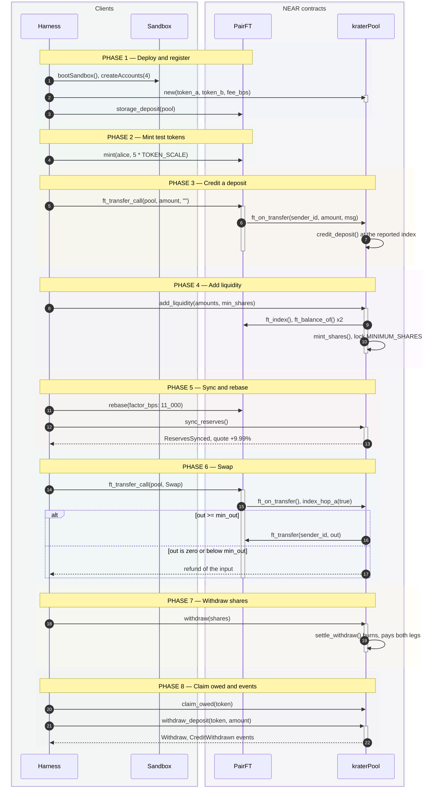

# krater
**A NEAR pool whose reserves are the real NEP-141 balances it holds.** Rebase, dividend, or taxed-transfer gains belong to the holders. No owner, pause, or upgrade path exists. Contract [`contracts/pool`](contracts/pool) (Rust, near-sdk 5.30.2), manifest [`manifest.json`](manifest.json), licence Apache-2.0.
Tracks: `defi`. Baseline: tag `pre-hackathon` marks the imported tree at `d6eafae` (upstream `nirholas/rebase-absorb`).



## Pool and shares
The pool holds both pair tokens on its own account, so the balance is the reserve. No wrapper, claim token, or cached price reconciliation is needed.
- A rebasing supply gain raises the pool balance. The next settlement quotes a larger reserve, so every LP share is worth more.
- A fee-on-transfer token is priced from what arrived, not from what was sent. A dividend or airdrop lands in the reserve and belongs to the shares.
The curve is constant-product with input-side fees. Views read a cached reserve. A permissionless sync chain refreshes it. Settlement always syncs before it trades.
LP shares are NEP-141 on the pool account. `FungibleToken` provides `ft_transfer`, `ft_transfer_call`, `ft_total_supply`, `ft_balance_of`, `ft_metadata`, `ft_resolve_transfer`, and the NEP-145 storage methods.
Settlement enters that standard. A holder calls `ft_transfer_call` on a pair token. The token calls `ft_on_transfer` on the pool, which quotes the reported net amount. An empty message credits a deposit, which `add_liquidity` spends. Every event is NEP-297 JSON under `krater`.

## Quickstart
Requirements: Rust 1.100.0+, edition 2024, cargo-near 0.23.0, near-cli-rs 0.31.1, wasm-opt (binaryen), Node 26.13.1+, pnpm 12.18.0+.
```bash
git clone https://github.com/nirholas/near-krater && cd near-krater && cargo near build non-reproducible-wasm && node scripts/demo.js
```
`scripts/demo.js` starts a near-sandbox chain, deploys both contracts, creates zero-balance accounts, and runs the full flow. It needs no keys or funds. Call `storage_deposit` on both tokens and the pool first, because NEP-141 never registers receivers.
`non-reproducible-wasm` builds locally without Docker, and reproducible Docker releases need pushed source. `scripts/deploy.sh` builds both crates. It runs `scripts/optimize-wasm.sh`, which passes `wasm-opt -Oz --converge` with cargo-near features, sign-extension, element reordering, instruction optimization, and RSE after `-O`. It cuts pool wasm from `275,053` to `269,972` bytes (−1.85%). Set `RPC_URL` and header variables for live networks.

## Executable spec
Each command starts a zero-funds sandbox and deploys both contracts. `node scripts/demo.js` runs deposit credits, add liquidity, quote, swap, rebase and sync, and withdraw. It prints reserves, shares, the quote delta in bps, and the `Swap` count, and exits non-zero on failure.
`node scripts/measure.js` measures gas for each settlement path and the +10% rebase quote delta. `node --test --test-concurrency=1 tests/pool.test.js` covers the refund and owed path, `claim_owed`, `withdraw_deposit`, taxed legs, and seeded fuzz, plus refund and claim paths for unregistered payout receivers. `cargo check --workspace --target wasm32-unknown-unknown && cargo test -p krater-pool` compiles, runs unit tests, and builds wasm.

### Repro steps
1. Build the wasm: do `cargo near build non-reproducible-wasm` → see `target/near/krater_pool/krater_pool.wasm` and `target/near/krater_mock_ft/krater_mock_ft.wasm` exist.
2. Run the end-to-end demo: do `node scripts/demo.js` → see `krater demo ok (sandbox): pool.<id>`.
3. Measure gas and the rebase delta: do `node scripts/measure.js` → see `bench.json` written and `get_quote` rise from `9.920546077802156251e18` to `1.0912600685582371876e19` on a +10% rebase (+9.99%).
4. Run the surface tests: do `node --test --test-concurrency=1 tests/pool.test.js` → see 35 tests, 0 fail.
5. One-contract deploy oracle: do `POOL_WASM=target/near/krater_pool/krater_pool.wasm MOCK_FT_WASM=target/near/krater_mock_ft/krater_mock_ft.wasm node scripts/smoke.mjs` → see `DEPLOY_OK pool_name="krater" pool_version="1.0.0"`.

## Claim → evidence

| Claim | Evidence |
|---|---|
| No owner, pause, or upgrade path | `contracts/pool/src/lib.rs:6-7` ("The pool has no owner, no pause and no upgrade path"); no `pause`/`upgrade` method exists in `contracts/pool/src` |
| Reserves are the real NEP-141 balances held | `contracts/pool/src/pool.rs:79` `get_reserves`, `contracts/pool/src/pool.rs:110` `sync_reserves`; test `tests/pool.test.js:472` "a rebase is priced after sync_reserves" |
| Quote delta +9.99% on a +10% rebase | `scripts/measure.js`; numbers above reproduced per run |
| Taxed transfers priced from what arrived | test `tests/pool.test.js:1198` "taxed token reports net" |
| Failed payouts become withdrawable owed | test `tests/pool.test.js:555` "a failed payout becomes owed and claim_owed clears it" |
| 35 surface tests, 0 fail | `node --test --test-concurrency=1 tests/pool.test.js` |

## Numbers, gas and limits
Run `node scripts/measure.js`. A +10% rebase raises `get_quote` by 9.99% in one sandbox run, from `9.920546077802156251e18` to `1.0912600685582371876e19` base units. The script writes `bench.json` and prints each path. Measured gas: `add_liquidity` 21.397 Tgas, `sync_reserves` 17.250 Tgas, and `withdraw` 28.635 Tgas. Also `swap` 28.110 Tgas, `withdraw_deposit` 10.356 Tgas, and `claim_owed` 6.478 Tgas. Gas sums the transaction `gas_burnt` and every receipt `gas_burnt`. Live runs need fixture accounts and two funded keys. The quote delta is deterministic. Gas varies slightly across node schedules.
Static gas makes client budgeting exact. The pool attaches 90, 80, 70, and 60 Tgas to the four sync callbacks. It attaches 25 Tgas to fill and 45 Tgas to settle. It attaches 8 Tgas to terminal callbacks and 5 Tgas to token views. It attaches 10 Tgas plus one yoctoNEAR to each `ft_transfer`.
The client attaches 200 Tgas to `ft_transfer_call`, and 300 Tgas to `add_liquidity` and `withdraw`. It attaches 100 Tgas to `sync_reserves` and 60–100 Tgas to `claim_owed` and `withdraw_deposit`. A call allows 1000 Tgas and a transaction 1 PGas. `300 Tgas` in `scripts/deploy.sh` for `new` sits inside that envelope. `scripts/demo.js` and `scripts/measure.js` attach these budgets, and `measure.js` rejects reverted or over-budget paths.

## Limits, layout and origin
- Holding real tokens costs more per settlement than accounting-only designs. Exact-output swaps are refused rather than approximated, because a taxed token cannot guarantee exact delivery. A direct transfer donates to all shares.
- Tokens that freeze or seize balances can do so here. A third-token airdrop cannot be recovered from the pool account.
- `get_quote` reads the last sync cache. Settlement syncs first, so a cached reserve is stale until the next settlement or permissionless `sync_reserves`. `ft_transfer_call` reports the net received amount, so a taxed input needs no over-sending router.
- `PoolEvent::Swap.amount_out_gross` records what the pool sent before any output token tax. Credits unspent by `add_liquidity` stay withdrawable through `withdraw_deposit` and stay out of tradeable reserves. Every swap, add, and withdrawal syncs first in its own transaction.
`contracts/mock-ft` is an unauthenticated test fixture that combines `rebase(factor_bps)`, `set_fee(bps)`, and free `mint`. It exposes balances, supply, metadata, index, and mutators for deterministic tests.
`contracts/pool/src/lib.rs` holds state, `new`, and the metadata and credit views. `contracts/pool/src/pool.rs` holds the quote math, `get_reserves`, and `get_quote`. `contracts/pool/src/shares.rs` holds share and credit arithmetic and `MINIMUM_SHARES`. `contracts/pool/src/ft_receiver.rs` holds the `ft_transfer_call` messages, and `contracts/pool/src/events.rs` holds the NEP-297 event enum. `contracts/mock-ft/src/lib.rs` is the rebasing and fee-on-transfer fixture.
`scripts/demo.js` runs the sandbox or live end-to-end flow. `scripts/measure.js` measures gas and the rebase delta and writes `bench.json`. `scripts/lib/harness.js` is the shared sandbox and RPC client for demo, measure, and tests. `tests/pool.test.js` tests the deployed surface. `manifest.json` is the machine-readable pool description.
krater ports [`nirholas/rebase-absorb`](https://github.com/nirholas/rebase-absorb) (Apache-2.0) from Solidity to Rust and NEP-141, keeping `LICENSE` verbatim and `NOTICE` with the origin line corrected. See [`ATTRIBUTION.md`](ATTRIBUTION.md) for the change summary and dependency licences. Track: `defi`. Local submission draft: [`SUBMISSION-PREP.md`](SUBMISSION-PREP.md).

Q-015 (second project on this email): **subrosa** (private payroll, tracks `privacy`, `realworld`).

## Baseline and disclosure

Baseline: tag `pre-hackathon` marks the imported tree at `d6eafae`. The upstream project is `nirholas/rebase-absorb`.
Submission: tag `hackathon-submission` marks the submitted state. `git rev-parse --short hackathon-submission` prints it.
Diff: `git diff pre-hackathon..hackathon-submission`. After publishing, https://github.com/<owner>/<repo>/compare/pre-hackathon...hackathon-submission.
Libraries, templates and AI-generated code are listed in `ATTRIBUTION.md` and `NOTICE`.
